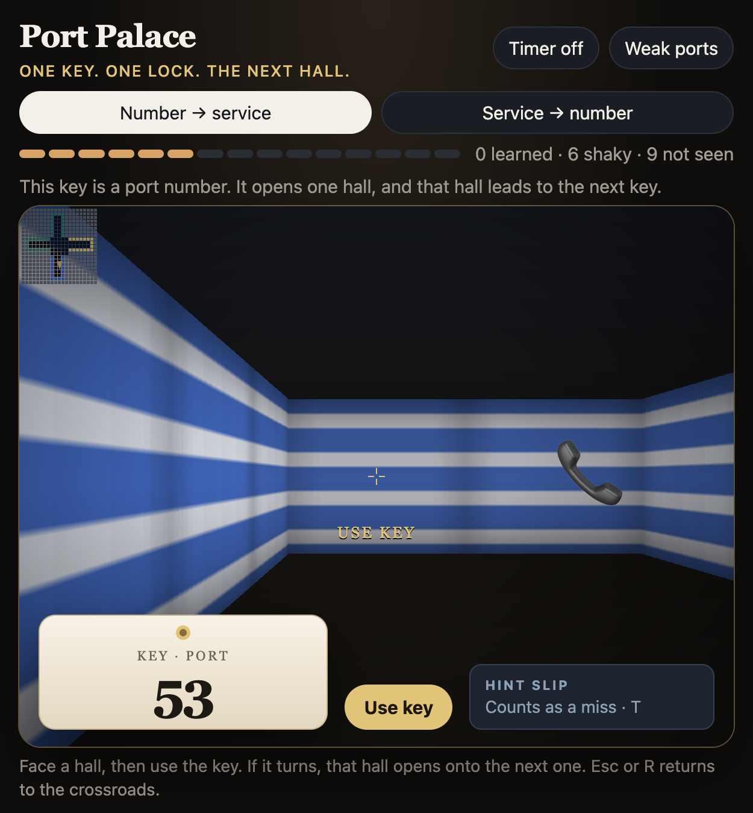

# Port Palace

Learn the Security+ port numbers by walking through them.

Every port gets its own hallway with its own look: colors, wallpaper, and a landmark tied to what the service does. You get a key stamped with a port number, walk up to the hall it belongs to, and turn the key. If it fits, the next hall opens. If not, the key jams, and the game tells you which hall you actually walked into so you learn both ports at once.

## How it plays

- **One key, one lock, the next hall.** Each correct answer unlocks the next key in the chain.
- **Two modes:** Number → service, and Service → number.
- **Twins get taught together.** 389 is the open cabinet (LDAP), 636 is the locked cabinet (LDAPS). Miss one and you get both.
- **Progress tracking:** every port moves from not seen to shaky to learned as you answer.
- **Weak ports** mode drills the ones you keep missing.
- **Optional timer** if you want pressure.

## Controls

- Up / Down: walk
- Left / Right: turn
- A / D: strafe
- Drag: look around
- Use key: try the key in the hall you're facing
- T: hint slip (counts as a miss)
- Esc or R: back to the crossroads

## Run it

It's a single file with no dependencies. Open `index.html` in a browser, or visit the live version on GitHub Pages.

## Why a memory palace?

Placing facts in distinct physical spaces makes them stick better than flat flashcards. Walking into the wrong hallway and seeing why it's wrong is a stronger memory than a red X.

## Notes

This is a personal study aid for the CompTIA Security+ port list. It isn't affiliated with or endorsed by CompTIA, and it contains no official exam content. Port numbers are public.

## License

MIT
